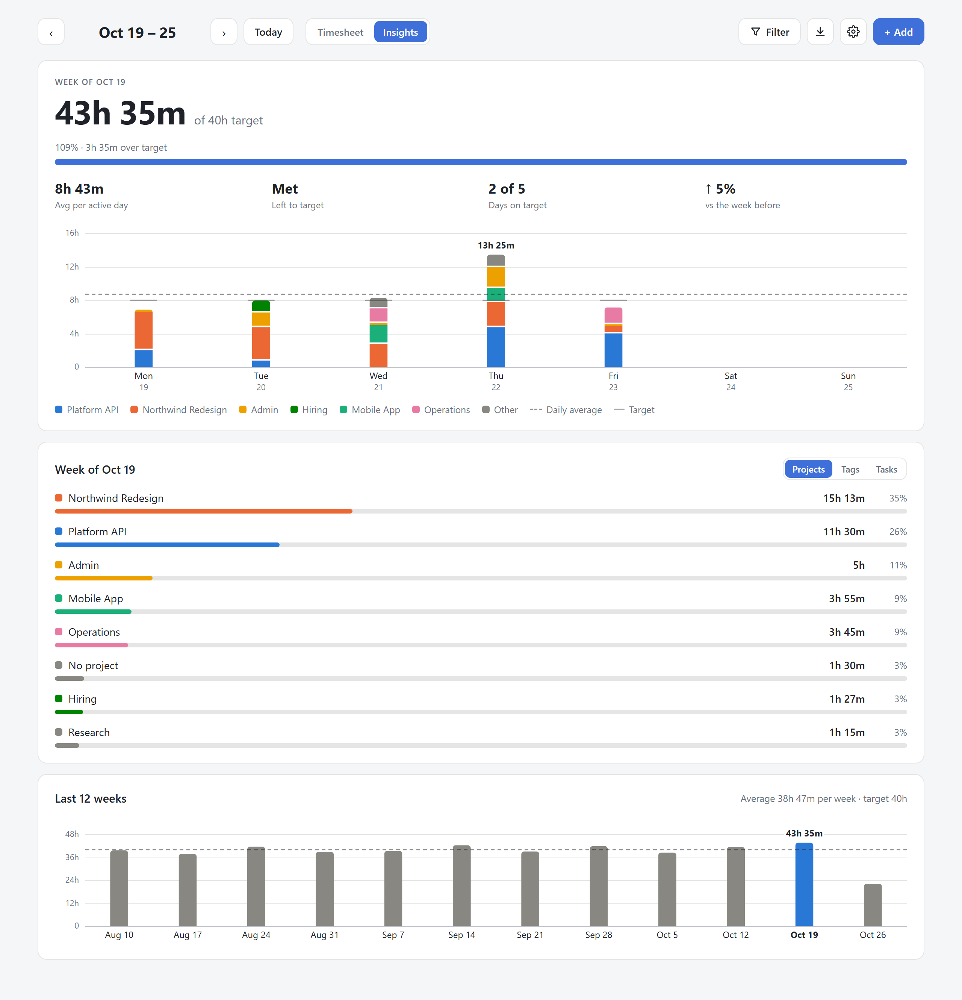
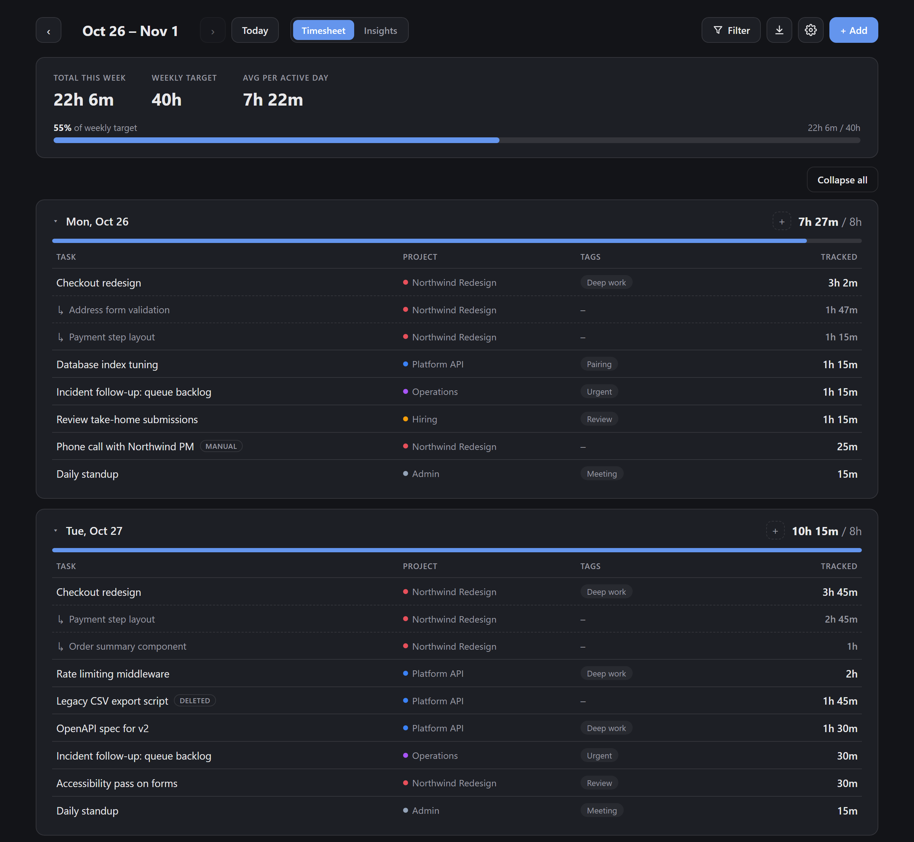
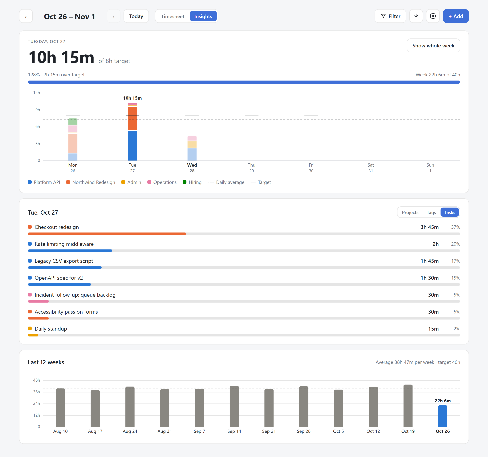
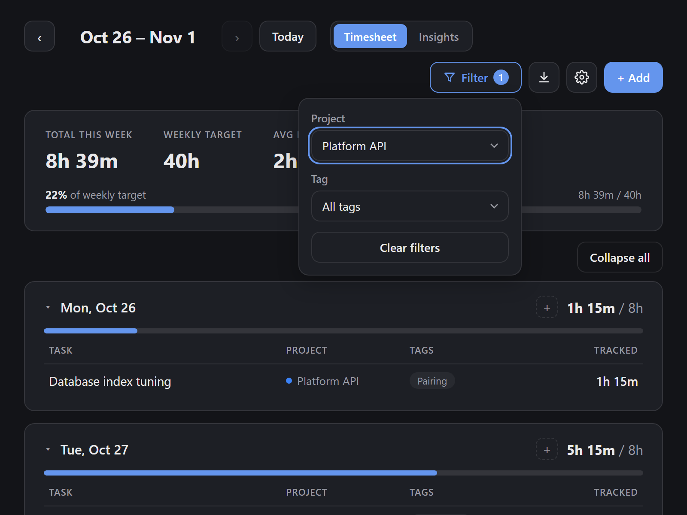
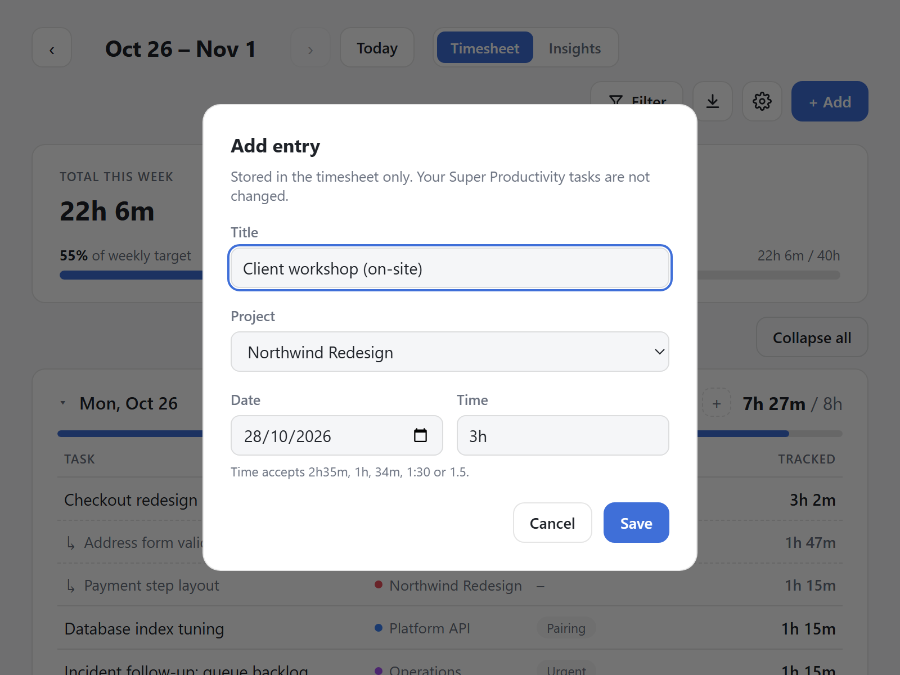
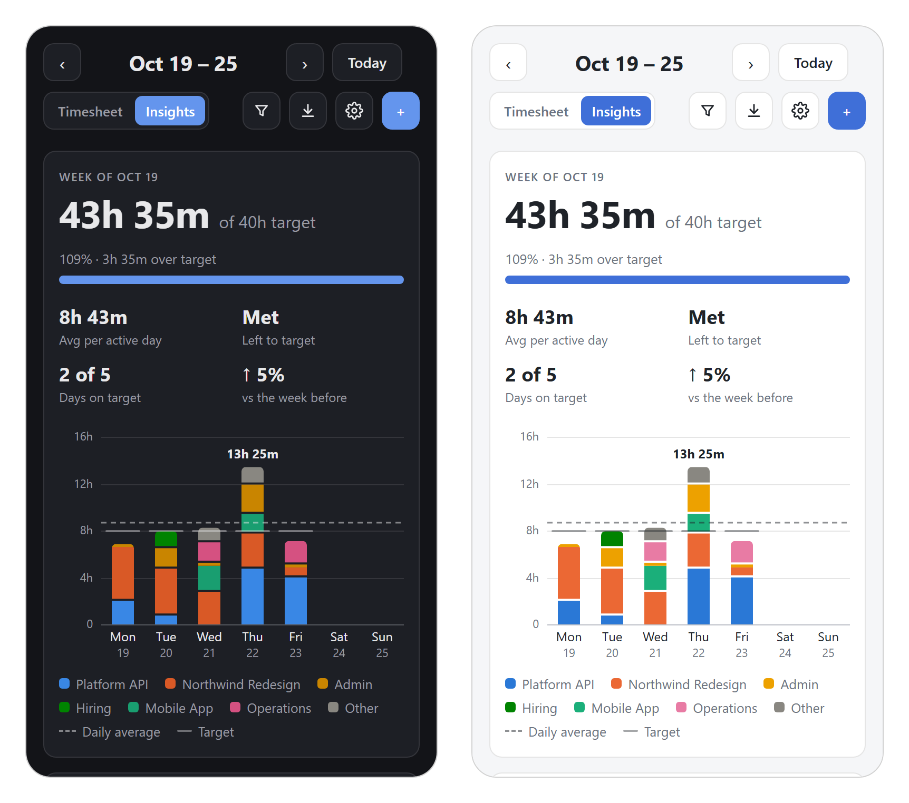
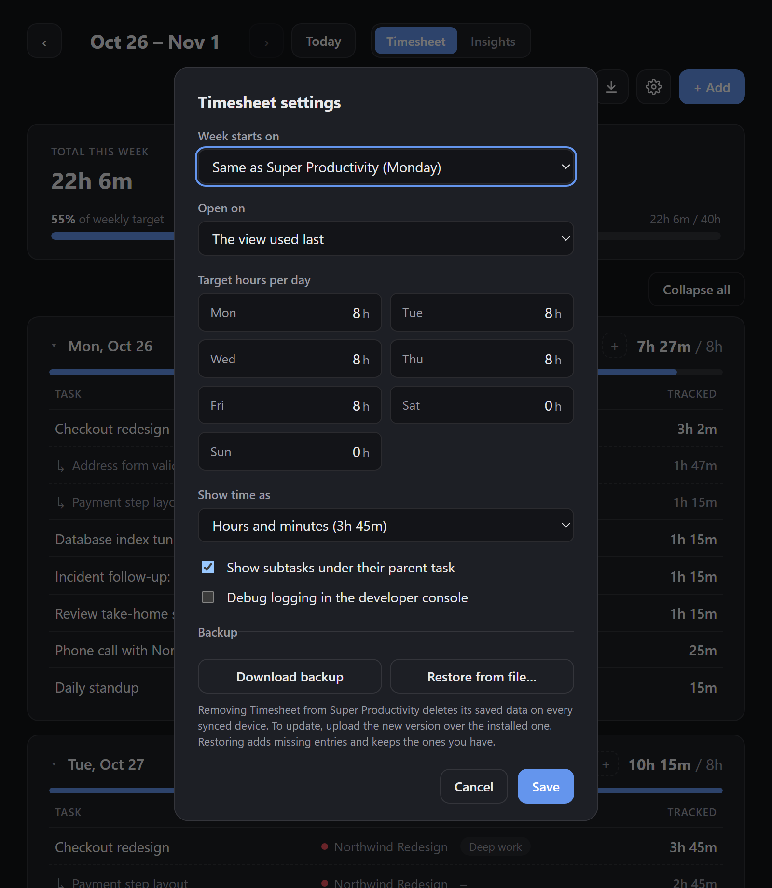
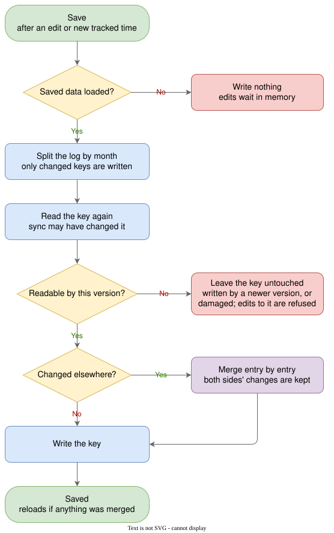
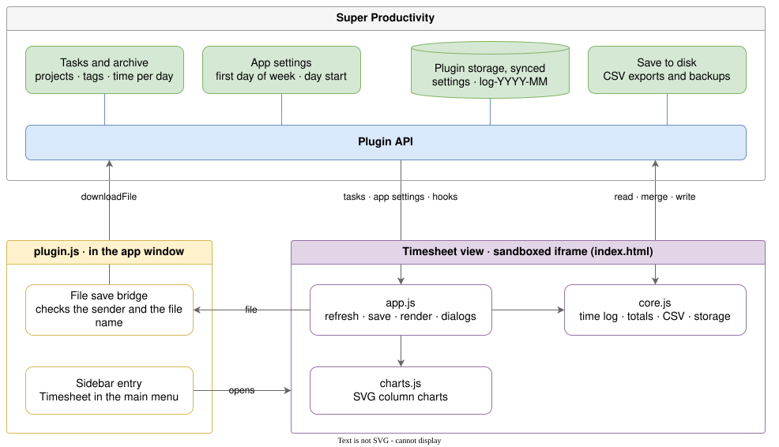

# Timesheet for Super Productivity

A weekly timesheet and charts for the time you track in [Super Productivity](https://super-productivity.com). It lists what you worked on each day, measures it against daily and weekly targets, and keeps the hours on record after a task is deleted.

<picture>
  <source media="(prefers-color-scheme: dark)" srcset="docs/images/insights-dark.png">
  <source media="(prefers-color-scheme: light)" srcset="docs/images/insights-light.png">
  
</picture>

<sub>Screenshots show a generated demo workload of nine projects over twelve weeks (see [Screenshots and demo data](#screenshots-and-demo-data)).</sub>

## Features

**Timesheet**

- One card per day listing each task with its project, tags and tracked time, and a bar showing progress toward that day's target.
- Week totals: tracked time, weekly target and average per active day.
- Manual entries for work done away from the app, such as calls, meetings or travel.
- Hours stay on record after a task is deleted in Super Productivity. The row is marked *Deleted* and still counts.
- CSV export of the week on screen, with the current filters applied.

**Insights**

- The week as one stacked column per day, colored by project, with a daily-average line and a mark at each day's target.
- Progress toward the weekly target, with a pace marker that shows where you would be if every day so far had met its target. Alongside it: average per active day, time left to target, days on target, and the change against the previous week.
- A breakdown of the week, or of one selected day, by project, tag or task.
- Weekly totals for the last 12 weeks against the weekly target.

**Throughout**

- Filters for project (including *No project*) and tag. A tag filter also matches subtasks.
- Follows Super Productivity's light or dark theme and works at phone width.
- Backup and restore of all Timesheet data as a single file.
- No network access. Data stays in Super Productivity's own storage and syncs with the rest of your data.

## Screenshots

<table>
  <tr>
    <td width="50%" valign="top">
      
      <p><b>Timesheet.</b> Subtasks are listed under their parent. Manual entries and deleted tasks are labelled.</p>
    </td>
    <td width="50%" valign="top">
      
      <p><b>A selected day.</b> The headline and breakdown switch to that day; here the breakdown is by task.</p>
    </td>
  </tr>
  <tr>
    <td width="50%" valign="top">
      
      <p><b>Filters.</b> Project and tag, applied to both views and to the CSV export.</p>
    </td>
    <td width="50%" valign="top">
      
      <p><b>Manual entry.</b> Durations can be typed as <code>1h 30m</code>, <code>90m</code>, <code>1.5</code> or <code>1:30</code>.</p>
    </td>
  </tr>
  <tr>
    <td colspan="2" align="center">
      
      <p><b>Phone width,</b> in the dark and light themes. The header wraps into two rows.</p>
    </td>
  </tr>
</table>

## Installation

Requires Super Productivity 14.0.0 or newer.

**From the app**, once the plugin is listed: **Settings → Plugins → Community Plugins → Timesheet → Install**.

**From a release:**

1. Download `sp-timesheet-vX.Y.Z.zip` from [Releases](https://github.com/AshrafByte/sp-timesheet/releases).
2. In Super Productivity, open **Settings → Plugins → Choose Plugin File** and select the zip. Plugins are installed from the zip file itself, not from an extracted folder.
3. Open **Timesheet** from the sidebar.

### Updating

Upload the new zip the same way, over the installed version. Your data is kept.

> [!WARNING]
> Do not remove the plugin in order to update it. Removing a plugin in Super Productivity deletes its saved data, including manual entries and the hours of deleted tasks, on every device that syncs. Before major changes, download a backup from Timesheet's settings.

## Using Timesheet

**Weeks and views.** Use ‹ and › to change week and **Today** to return to the current one. **Timesheet** and **Insights** switch views; which one opens first is set in settings. On a touchscreen, swipe the week chart sideways to change week.

**Selecting a day.** In Insights, select a day's column to focus the headline and breakdown on it. The other days fade. Select it again, or choose **Show whole week**, to go back. Selecting a week in the 12-week chart opens that week.

**Keyboard.** Chart columns can be focused with Tab. The arrow keys move between them and Enter or Space selects one. Escape closes the filter popover and dialogs.

**Entries.** Rows of tasks that exist in Super Productivity are read-only here; their time is edited in the app. **+ Add** (or the **+** on a day card) creates a manual entry with a title, optional project, date and duration. Manual entries and deleted tasks can be edited, moved to another date or removed. Moving an entry onto a day where it already has time adds the two.

**Export.** The download button saves the week on screen as `timesheet-YYYY-MM-DD-to-YYYY-MM-DD.csv`, with the columns `Date`, `Task`, `Project`, `Tags`, `Hours`, `Duration` and `Source` (`Super Productivity`, `Manual` or `Deleted task`). Rows match the totals shown, so a parent task is counted once.

## How time is counted

- Super Productivity records tracked time per task per day, and Timesheet shows exactly that. It has no start and end times because the app does not record them.
- A parent task's time already includes its subtasks, so totals count the parent once and list the subtasks as detail. If a subtask is deleted, its hours still count.
- "Today" follows Super Productivity's *Start of next day* setting. A day that ends at 4 am in the app ends at 4 am here too.
- A project keeps its color across weeks and filters. Colors go to the projects with the most tracked time overall, from a palette checked for color-blind separation in both themes. Beyond eight projects, the smaller ones share *Other*.
- Timesheet can only keep hours it has seen. A task deleted before Timesheet was first opened cannot be recovered.

## Settings

Open settings with the gear button in Timesheet's header.

<p align="center">
  
</p>

| Setting | Description |
| --- | --- |
| Week starts on | Any weekday, or *Same as Super Productivity*, which follows the app's *First day of week* (or your locale when that is set to *System default*). New installs follow the app. |
| Open on | The view used last on this device, or always Timesheet, or always Insights. |
| Target hours per day | A target for each weekday. The weekly target is their sum. Leave a day at 0 for no target. |
| Show time as | Hours and minutes (`3h 45m`) or decimal hours (`3.75h`). |
| Show subtasks | Lists subtasks under their parent task. Totals are the same either way. |
| Debug logging | Writes diagnostic messages to the developer console. Off by default. |
| Backup | **Download backup** saves all Timesheet data as `timesheet-backup-YYYY-MM-DD.json`. **Restore from file** adds entries and days the timesheet does not have and applies the backup's settings. It never removes anything. |

## Data, sync and privacy

Timesheet makes no network requests. It reads tasks, projects, tags and the app's settings, and never changes or deletes them. Its own data is stored with Super Productivity's synced plugin storage, so it travels with the rest of your data.

| Permission | Used for |
| --- | --- |
| `getTasks`, `getArchivedTasks` | Tracked time per task and day, including archived tasks. |
| `getAllProjects`, `getAllTags` | Names and colors for rows, filters and charts. |
| `loadSyncedData`, `persistDataSynced`, `listSyncedDataKeys` | Reading and saving Timesheet's own data. |
| `showSnack` | Short messages, such as a failed save. |
| `downloadFile` | Saving CSV exports and backups. |

The plugin also listens to app events (task changes, task deletion, finishing the day, synced data changes) to refresh the view and to record a task's hours before it disappears.

**Storage layout.** Settings are stored under one key and the time log under one key per month (`log-YYYY-MM`), split further for a very busy month because a single write is limited to 256 KB. A running timer therefore rewrites only the current month. On app versions without keyed storage, everything is kept in a single entry.

### How saved data is protected

<picture>
  <source media="(prefers-color-scheme: dark)" srcset="docs/images/saving-dark.svg">
  <source media="(prefers-color-scheme: light)" srcset="docs/images/saving-light.svg">
  
</picture>

- **Other devices.** Before writing a month, Timesheet reads it again. If another device changed it, the two versions are merged entry by entry instead of one replacing the other. A device opening Timesheet for the first time waits a minute before saving automatically, so sync can deliver data from other devices first.
- **Newer plugin versions.** Data written by a newer version of Timesheet is never overwritten or merged into. Timesheet shows a notice, and edits that would land in that data are refused with a message instead of being lost.
- **Failed loads and saves.** Nothing is written until saved data has loaded successfully. Edits that could not be saved stay in memory, are retried, and are saved before any reload.
- **Changes in Super Productivity.** A task whose tracked time is missing or in an unknown format keeps its logged hours. If many logged tasks disappear at once, for example when the archive fails to load, Timesheet checks again a minute later before marking them deleted.

## Compatibility

- **Super Productivity 14.0.0 or newer.** Keyed plugin storage is used where the app provides it; older versions keep all data in a single entry.
- **Plugin file size.** Versions before the 1 MB limit ([#10578](https://github.com/super-productivity/super-productivity/issues/10578)) reject an `index.html` over 100 KB. The release build is minified to stay well under it, and the build fails if it would not.
- **Timesheet 1.x.** Data from 1.x is migrated on first start. On apps with keyed storage, the 1.x entry is left in place as a fallback.

## Architecture

<picture>
  <source media="(prefers-color-scheme: dark)" srcset="docs/images/architecture-dark.svg">
  <source media="(prefers-color-scheme: light)" srcset="docs/images/architecture-light.svg">
  
</picture>

The plugin has two parts, as Super Productivity runs them:

- **`plugin.js`** runs in the app window. It adds the sidebar entry and saves files on the view's behalf, because a sandboxed iframe cannot start downloads. It accepts a save request only from Timesheet's own view and only for a `.csv` or `.json` file name.
- **`index.html`** is the view, loaded in a sandboxed iframe. The build inlines the styles and three scripts into it:
  - `app.js` fetches tasks, listens for app events, schedules saves and renders both views and the dialogs.
  - `core.js` holds the logic, with no DOM or API access: dates and durations, the time log, totals, chart data, CSV, backups and the storage layer. It is what the tests cover.
  - `charts.js` draws the SVG column charts from plain data, with tooltips and keyboard support.

The diagrams are drawn in draw.io. The source is [`docs/diagrams/timesheet.drawio`](docs/diagrams/timesheet.drawio), with one page per diagram.

### Repository layout

| Path | Contents |
| --- | --- |
| `src/manifest.json` | Plugin manifest. Its version is the only version number. |
| `src/core.js`, `src/charts.js`, `src/app.js` | The view's logic, charts and UI (see above). |
| `src/index.html`, `src/styles.css` | Markup and styles. |
| `src/plugin.js` | Code that runs in the app window. |
| `scripts/` | Build, reproducible zip writer, dev server, screenshot capture. |
| `dev/` | Mock plugin API, demo data and a stand-in host window. Never shipped. |
| `tests/` | `node --test` suites. |
| `docs/` | README images and the draw.io source. |

## Development

Requires Node 20 or newer. The only dependency is esbuild, used for minifying and pinned to an exact version.

```bash
npm ci          # install the pinned esbuild
npm test        # unit, storage, safety and build tests
npm run build   # write the plugin zip and listing entry to dist/
npm run dev     # build, then serve on http://localhost:5178
```

`npm run dev` serves three pages:

- `/dist/dev.html` runs the view against a mock plugin API with sample data and a running timer. `window.__mock` in the console can delete tasks, finish the day or simulate a sync from another device.
- `/dist/dev-release.html` does the same with the minified release code.
- `/dev/host.html` runs the built `plugin.js` in a stand-in app window, which covers CSV export and backups. Add `?release=1` for the release code.

The mock API accepts these query parameters:

| Parameter | Effect |
| --- | --- |
| `theme=light` | Light theme (dark is the default). |
| `host=old` | An app without keyed storage. |
| `seed=v1` | Start from Timesheet 1.x data. |
| `reset=1` | Clear saved data first. |
| `timer=0` | No running timer. |
| `firstDay=0..6`, `dayStart=HH:MM` | The app's *First day of week* and *Start of next day*. |
| `demo=busy` | The demo workload used for screenshots. |

### Screenshots and demo data

The images in `docs/images` are generated, not edited by hand. `dev/demo.js` builds a seeded workload (nine projects, twelve weeks up to today, subtasks, manual entries and a deleted task) and scripts each view state. To regenerate the screenshots with a local Chrome or Edge:

```bash
npm run build
node scripts/screenshots.mjs            # all
node scripts/screenshots.mjs phones     # one
```

Set `CHROME` to the browser's executable if it is not found. The diagrams are exported with the draw.io desktop app's command line, one light and one dark SVG per page. For the first page:

```bash
drawio -x -f svg -p 1 --theme light -t -b 8 --embed-svg-fonts false -o docs/images/architecture-light.svg docs/diagrams/timesheet.drawio
```

### Size limit

The build stops with an error if the release `index.html` exceeds 100 KB and warns above 90 KB. The release copy is minified, local names included, so read the source in `src/` or open `dist/dev.html` instead.

### Releasing

1. Bump `version` in `src/manifest.json`, add a `CHANGELOG.md` entry, and run `npm test`.
2. Run `npm ci && npm run build`. The zip is reproducible: the same source and the pinned esbuild produce the same SHA-256, so a reviewer can rebuild it and compare.
3. Create the GitHub release `vX.Y.Z` and attach `dist/sp-timesheet-vX.Y.Z.zip`.
4. Open a pull request to [super-productivity](https://github.com/super-productivity/super-productivity) that adds or updates the entry in `src/assets/community-plugins.json` with the contents of `dist/community-plugins-entry.json`.

## License

MIT. See [LICENSE](LICENSE).
